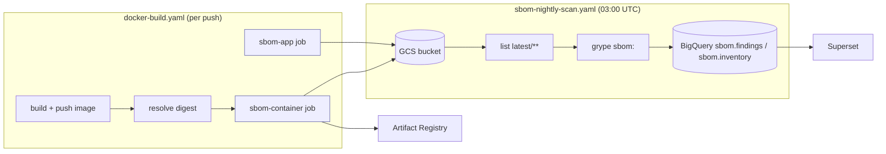

# SBOM pipeline

Central SBOM generation and CVE scanning for every repository that builds through
`docker-build.yaml`. Consuming repositories need no workflow changes: they already
call `HDRUK/github-actions-templates/.github/workflows/docker-build.yaml@main`.

## What is produced

Two CycloneDX SBOMs per build, owned and reported separately.

| Layer | Source | Contents | Owner can fix by |
| --- | --- | --- | --- |
| `app` | `syft scan dir:.` after dependency install | npm, pip, composer packages (lockfiles) | updating dependencies |
| `container` | `syft scan registry:<image@digest>` | OS packages and binaries only (`--select-catalogers os,binary`) | bumping or rebuilding the base image |

Every SBOM is scanned with Grype. **Findings are report only: they never fail a
build.** They appear in the job summary and (via the nightly scan) in BigQuery.
**Tool errors do fail the build** when SBOM is enabled (Syft/Grype crash, GCS or
Artifact Registry upload failure).

## Flow



The container job needs the pushed digest so it runs after `build`; the app job
runs in parallel with it.

## Components

| Path | Purpose |
|---|---|
| `.github/actions/sbom-gate` | Turns `SBOM_*` variables into `run_app`, `run_container`, `upload_ar` |
| `.github/actions/sbom-app` | App SBOM, scan, summary, GCS upload |
| `.github/actions/sbom-container` | Container SBOM, scan, summary, GCS upload, Artifact Registry attach |
| `.github/workflows/sbom-nightly-scan.yaml` | Nightly re-scan into BigQuery |
| `scripts/sbom/sbom_lib.py` | Tested logic: gate, paths, flattening, nightly loop |
| `scripts/sbom/cli.py` | Thin CLI over the library |
| `scripts/sbom/install_tools.sh` | Installs pinned Syft/Grype with checksum verification |

## Storage layout

```text
gs://<SBOM_BUCKET>/latest/<org>/<repo>/<layer>/<ref>.cdx.json                 overwritten each build; read by nightly scan
gs://<SBOM_BUCKET>/history/<org>/<repo>/<layer>/<ref>/<sha>.cdx.json          expires after 90 days
gs://<SBOM_BUCKET>/releases/<org>/<repo>/<layer>/<ref>/<sha>.cdx.json         tags and release/* branches; kept
```

This differs from the original brief, which put `<ref>` before `latest`. The top-level
`history/` prefix exists so a GCS lifecycle rule (which matches by prefix only) can
expire history without touching `latest/` or `releases/`.

`<ref>` is sanitised (`feat/x` becomes `feat-x`, path traversal characters removed).
Object metadata: `repo`, `layer`, `ref`, `sha`, `run`.
The SBOM itself also records `sbom:layer` and `sbom:image_digest`
as CycloneDX metadata properties so the nightly scan needs no side data.

## BigQuery

`sbom.findings` and `sbom.inventory`: see [sbom-infrastructure.md](../OPERATIONS/sbom-infrastructure.md) for DDL.

## Decisions

- No enforce or gating mode for findings. Reviewed and rejected: vulnerability backlogs are tracked in Superset rather than blocking deploys.
- Syft and Grype versions are pinned in the composite actions and installed from GitHub releases with checksum verification, instead of marketplace actions.
- Pull request builds never run SBOM jobs (no cloud credentials, no durable value).
- Base image is not tracked. Container findings are grouped by repo and package; add base image detection only if dashboards need it.

## Known items to verify on first pilot run

- `gcloud artifacts sbom load` accepts CycloneDX 1.5 as generated (`cyclonedx-json@1.5`).
- Environment-scoped variables shadow organisation/repository variables in jobs that declare `environment:`; the SBOM jobs do, matching `build`.
- The composite actions are referenced `@main`, so they must merge to `main` together with the workflow change.
