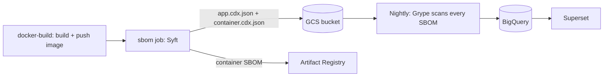

# SBOM pipeline

An SBOM (software bill of materials) is a list of every package an application is built from. We generate
two for each build, store them in one bucket, and scan them every night for known vulnerabilities.

## How it works



1. **On every build** of an enabled repository, a job in `docker-build.yaml` runs after the image is pushed and creates:
   - an **app SBOM**: npm, pip and composer packages, read from the repo's lockfiles. The app team fixes these by updating dependencies.
   - a **container SBOM**: operating system packages and binaries inside the pushed image. These are fixed by rebuilding the image.
2. Both are uploaded to the bucket, and the container SBOM is also attached to the image in Artifact Registry so it shows next to the image in the GCP console. **Nothing is scanned during the build**, so builds stay fast and can't be failed by a new CVE.
3. **Every night** `sbom-nightly-scan.yaml` scans each stored SBOM against a fresh vulnerability database and loads the results into BigQuery.
4. **Superset** reads BigQuery for dashboards.

## Where things are

| File | What it does |
|---|---|
| `.github/workflows/docker-build.yaml` (`sbom` job) | Builds and uploads both SBOMs |
| `.github/workflows/sbom-nightly-scan.yaml` | Runs the nightly scan |
| `scripts/sbom/nightly.sh` | The scan loop: download, Grype, flatten, load to BigQuery |
| `scripts/sbom/flatten.jq`, `inventory.jq` | Turn Grype and SBOM output into BigQuery rows |
| `scripts/sbom/test.sh` | Tests for the two jq filters (`.github/workflows/sbom-tests.yaml` runs it) |

## Storage

```
gs://<SBOM_BUCKET>/branches/<org>/<repo>/<app|container>/<ref>.cdx.json    overwritten each build, expires after 90 days
gs://<SBOM_BUCKET>/releases/<org>/<repo>/<app|container>/<ref>.cdx.json    tags and release/* branches, kept
```

`<ref>` is the branch or tag name with anything other than letters, digits, `.`, `_` and `-` replaced by `-`
(`feat/x` becomes `feat-x`). The two folders exist so one lifecycle rule can expire `branches/` without touching releases.
SBOMs list a repository's full dependency inventory, so the bucket must be private.

## Settings

Set these as GitHub Actions **variables** at organisation level (limited to selected repositories to roll out in stages).
A repository-level variable overrides the organisation one. Nothing is hard-coded in consuming repositories.

**`SBOM_ENABLED`** (`true`, default off)
The on/off switch. Anything other than `true` means no SBOM job runs and the build is unchanged. It never runs on pull requests.
To switch it off everywhere, set it to `false`; this takes effect on the next run with no code change.

**`SBOM_BUCKET`** (required)
Name of the bucket the SBOMs are written to. It must already exist. If it is wrong or missing, the upload fails and so does the build.

**`SBOM_GCP_WIF_PROVIDER`** and **`SBOM_GCP_SERVICE_ACCOUNT`** (optional)
How the job logs in to Google Cloud without stored keys. If unset it reuses the same login as the image push, which only works
if that identity can also write to the SBOM bucket.

**`SBOM_EXCLUDES`** (optional, default `./node_modules`)
Space separated paths the app SBOM ignores. Setting it replaces the default.

For the nightly scan, set these on the `github-actions-templates` repository: `SBOM_BUCKET`, `SBOM_BQ_DATASET` (as `project.dataset`),
`SBOM_GCP_WIF_PROVIDER`, `SBOM_GCP_SERVICE_ACCOUNT`, and optionally the secret `SBOM_SLACK_WEBHOOK_URL`
(or the existing `SLACK_WEBHOOK_URL`). If a webhook is set, a Slack message is sent when the scan fails or fixable critical findings exist.

## What fails a build

If SBOM is enabled, a tool or upload error (Syft crash, bucket missing, login failure) fails the build. **Vulnerabilities never do**,
because builds don't scan for them. An outage of GCS or Google login could therefore fail builds in every enabled repository;
`SBOM_ENABLED=false` is the quick switch-off.

## Nightly scan

Runs at 03:00 UTC and on demand (Actions > SBOM nightly scan > Run workflow). An SBOM that can't be scanned is logged as a
warning and skipped, the rest are loaded, and the run is marked failed at the end so it is noticed. Re-running on the same day
adds duplicate rows for that date, so dashboards should filter on the latest `scan_date`.

## Superset

Superset reads `sbom.findings` and `sbom.inventory` through its existing BigQuery connection. Suggested dashboards: fixable
critical/high findings per repo (app layer), packages affecting the most repos (container layer), repos with no or stale SBOMs,
and releases only (`sbom_uri LIKE '%/releases/%'`).

```sql
-- Fixable critical/high by repo, app layer, latest scan
SELECT repo, severity, COUNT(*) AS findings
FROM sbom.findings
WHERE layer = 'app' AND fix_state = 'fixed' AND severity IN ('Critical', 'High')
  AND scan_date = (SELECT MAX(scan_date) FROM sbom.findings)
GROUP BY repo, severity ORDER BY findings DESC;
```

Artifact Registry's own scanner will still show language package CVEs for images in the GCP console. That is expected; the
app and container split lives here.
